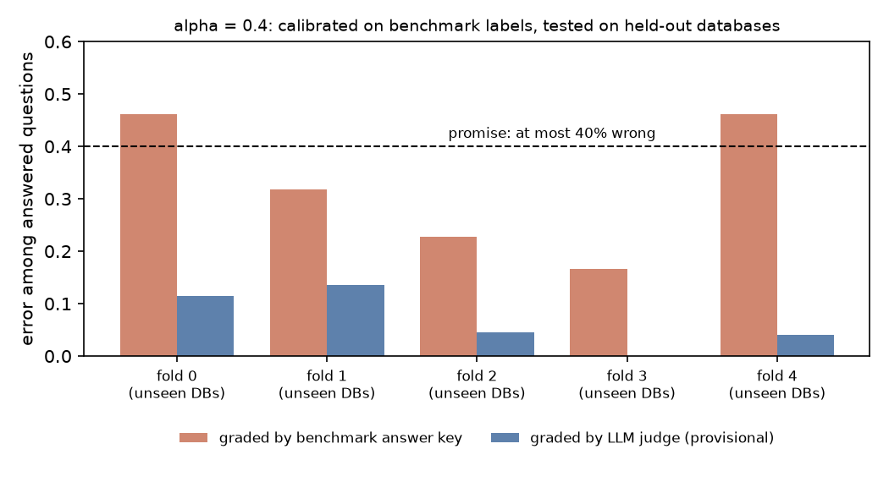

# Results: does the abstention guarantee hold?

## The guarantee
The agent answers a question only when it is confident enough; otherwise it abstains.

- **Confidence:** k = how many of 8 independent attempts return the same result table (1 to 8).
- **Calibration:** Learn-Then-Test (fixed-sequence testing, exact binomial p-values) picks the lowest threshold on k that is safe on a set of calibration questions.
- **The promise:** among the questions the agent answers, **at most α are wrong**, with probability at least 1 − δ = 90%.

What the terms mean:
- **Holds:** on new questions the real error among answered ones stays ≤ α, failing in no more than about 10% of trials.
- **Breaks:** the promise fails noticeably more often on unseen databases. The pre-registered rule: the violation rate on held-out-database splits exceeds the rate on random-question splits by at least 0.1.
- **Vacuous:** the agent answers fewer than 10% of questions. The promise is trivially kept but useless, and this does not count as "holds".

Two things can break it:
1. **Unreliable labels:** "wrong" is measured against the benchmark's answer key, which itself contains errors.
2. **Unseen databases:** the test questions come from databases the calibration never saw.

## Setup
- **Benchmark:** Spider 2.0-Lite, the 135 SQLite questions over 30 databases, pinned at commit `cafb867` (`manifests/spider2_lite_snapshot.json`).
- **Agent:** a single ReAct agent (`sqlabst/agent.py`) on Claude Haiku 5.5, T = 0.7. 8 runs per question, 1,080 runs in total (`manifests/run_m3_haiku55_t07.json`).
- **Splits:**
  - 5 fixed leave-database-out folds (`manifests/folds_ldo.json`);
  - 2,000 random held-out-database splits;
  - 2,000 random question splits (seed 20261105).
- **Settings:** δ = 0.1. The analysis plan was fixed before any result was computed.
- **Alternative labels:** an LLM judge (`openai/gpt-6.1-sol`, `tools/llm_judge.py`) re-graded every candidate answer blind, from a different model family than the agent. A second judge from a third family (`google/gemini-3.8-flash`, same tool, configs `configs/judge2_pilot.json` and `configs/judge2_full.json`) repeated this as a cross-check (Result 3).

## Result 1: graded by the benchmark answer key (`results/gonogo_bench_bench.json`)
The agent's main answer is wrong on 38.5% of questions according to the key.

| α | Coverage (held-out DBs) | Violation rate: held-out-DB splits | Violation rate: random-question splits | Verdict |
|---|---|---|---|---|
| 0.1 | 0% | – | – | vacuous |
| 0.2 | 0% | – | – | vacuous |
| 0.3 | 7% | 0.098 | 0.099 | vacuous |
| 0.4 | 77% | 0.216 | 0.182 | no pre-registered break (difference +0.034 < 0.1) |

At α = 0.4, two of the five fixed folds show **46% error against a 40% promise** (figure below).

## Result 2: graded by the LLM judge (provisional) (`results/gonogo_bench_judge_PROVISIONAL.json`, `results/gonogo_judge_sensitivity_PROVISIONAL.json`)
Calibration still uses the benchmark key, as a normal user would; only the grading of the test answers changes.

**Error of the agent's main answer**
| Grader | Error |
|---|---|
| benchmark key | 38.5% |
| judge, lenient (alternative readings count as correct) | 9.7% |
| judge, strict (alternative readings count as wrong) | 26.1% |

**Guarantee at α = 0.4 on held-out databases**
| Grader | Violation rate (5 folds / 2,000 random DB splits) | Real error of answered questions | Coverage |
|---|---|---|---|
| benchmark key | 0.40 / 0.216 | 0.34 / 0.33 | 0.84 / 0.77 |
| judge, lenient | **0.00 / 0.000** | 0.07 / 0.07 | 0.84 / 0.76 |
| judge, strict | **0.00 / 0.005** | 0.22 / 0.21 | 0.84 / 0.76 |

At α ≤ 0.3 the method stays vacuous under every grader, because calibration on the benchmark key sees too many (false) errors.

**What it would buy with clean labels** (calibrate and test on judge labels; exploratory):
- **Lenient:** α = 0.2 holds at **99% coverage** (risk 0.098). With benchmark calibration it is vacuous.
- **Strict:** α = 0.2–0.3 shows a held-out-database violation rate of 0.206, which hints at a database-shift effect. This is exploratory and not pre-registered.

## Result 3: a second AI judge (`results/gonogo_two_judges_PROVISIONAL.json`)
Same protocol, same blinded packets, same rules, graded by `google/gemini-3.8-flash`. Calibration still uses the benchmark key; only the grading of the test answers changes. 134 of 135 questions were submitted (local096 never was, so its main answer is excluded).

**Do the two judges agree?**
- On 619 tables graded by both: 80.5% agreement, Cohen's kappa 0.50.
- On the 132 main answers: 117 of 132 (88.6%).

**Error of the agent's main answer**
| Grader | Lenient | Strict |
|---|---|---|
| benchmark key | 38.5% | 38.5% |
| Sol | 9.7% | 26.1% |
| Gemini | 9.8% | 22.6% |

Both judges also reject a similar share of the official answer tables: Sol 22.5%, Gemini 27.7% (of 325 gold-containing tables graded by both).

**Guarantee at α = 0.4 on held-out databases (calibrated on the benchmark key)**
| Grader | Violation rate (random held-out-DB splits) | Real error of answered questions | Coverage |
|---|---|---|---|
| Sol, lenient | 0.000 | 0.07 | 76% |
| Gemini, lenient | 0.000 | 0.06 | 76% |
| Sol, strict | 0.005 | 0.21 | 76% |
| Gemini, strict | 0.009 | 0.17 | 76% |

At α ≤ 0.3 the method stays vacuous under both judges (0% coverage at α ≤ 0.2, 7% at α = 0.3). One of the five fixed folds shows a violation rate of 0.20 under Gemini's strict labels, which is not a pre-registered break.

**What this does and does not show.** The finding does not depend on which AI judge graded: two models from different families agree on about 89% of main answers and give the same picture. It does not show that the judges are right; both could be lenient in the same direction on alternative readings, and no human check has measured that.

## Result 4: other scores and calibrators, and a second agent (`results/score_grid.json`, `results/score_grid_glm53.json`, `results/gonogo_glm53_bench_bench.json`, `results/glm53_per_db_alpha02.json`)
**Other scores and calibrators (Haiku, no new model calls).** Three scores (run agreement k, loose agreement, answer entropy) times three calibrators (Learn-then-Test, Clopper-Pearson, Hoeffding, the last two with Bonferroni), 324 cells. Under the benchmark key all nine combinations are vacuous at alpha <= 0.2; only loose agreement with Learn-then-Test makes alpha = 0.3 usable (51% coverage). 163 of 324 cells are vacuous; 2 meet the break rule (both with Gemini labels).

**Second agent: GLM-5.3** (`z-ai/glm-5.3`, same prompt and settings, 8 runs on all 135 questions, cost $19.69; both judges on its 692 tables cost $10.97; Gemini has no verdicts for 3 questions).
| | Haiku 5.5 | GLM-5.3 |
|---|---|---|
| Main answer wrong by the key | 38.5% | 41.0% |
| Questions with all 8 runs agreeing | 41 | 15 |
| Key labels, alpha <= 0.3 | no usable threshold | no usable threshold |
| Key labels, alpha = 0.4: violation rate / coverage | 0.216 / 77% | 0.083 / 26% |
| Vacuous cells of 324 | 163 | 219 |
| Cells meeting the break rule | 2 | 2 |

With judge labels at alpha = 0.2 (lenient), GLM's held-out-database violation rate is 0.235 (Sol) and 0.219 (Gemini) against 0.168 and 0.090 on random question splits; Haiku's matching cells were 0.03 to 0.05. Leaving out one database at a time, the pooled held-out risk is 0.126 (Sol) and 0.148 (Gemini), inside alpha = 0.2. The databases above alpha are mostly tiny (1 to 3 questions); the one clear outlier on both judges is IPL (5 wrong of 11 answered).

**What this does and does not show.** Under the key the method is vacuous at the strict levels on two model families, so the vacuity is not specific to Haiku. The excess violations under judge labels on GLM are mostly small-test-set noise plus one hard database: a weak lead, not evidence of a failure on new databases. Two agents, one benchmark, one prompt and temperature each; no human-checked labels.

## Conclusion (provisional)
- **The guarantee holds on unseen databases, but it is over-cautious.** The apparent breaks under the benchmark key disappear when answers are graded by the judge: the key marks many correct answers wrong.
- The cost of the label errors is lost coverage, not broken promises. The method refuses everything at α ≤ 0.3, where clean labels would allow α = 0.2 with almost full coverage.
- **Why provisional:** the judge's labels are not yet corrected by the planned blind human check of 40 questions. The judge calls 87 of 135 questions ambiguous, so it may be lenient. The strict column is a worst case for that leniency.

## Reproduce
- Setup and data: see `README.md`.
- Go/no-go: `python tools/gonogo.py --calib-labels benchmark --test-labels benchmark`, with `--test-labels judge` for the judge version (which needs the judge outputs in `runs/`).
- Figure: `python tools/make_guarantee_figure.py`.
- Gemini judge: `python tools/gonogo.py --test-labels judge --judge-run judge_gemini38flash` (needs its outputs in `runs/`). The lenient/strict variants and the single file combining both judges (`results/gonogo_two_judges_PROVISIONAL.json`) come from an analysis script that is not in this repository.
